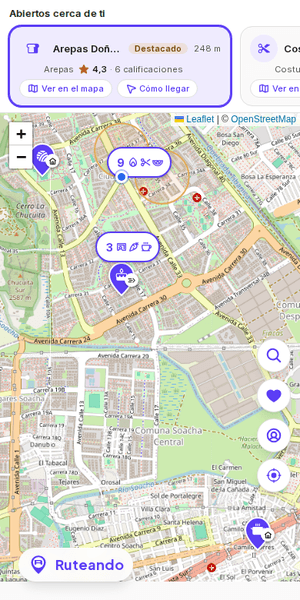
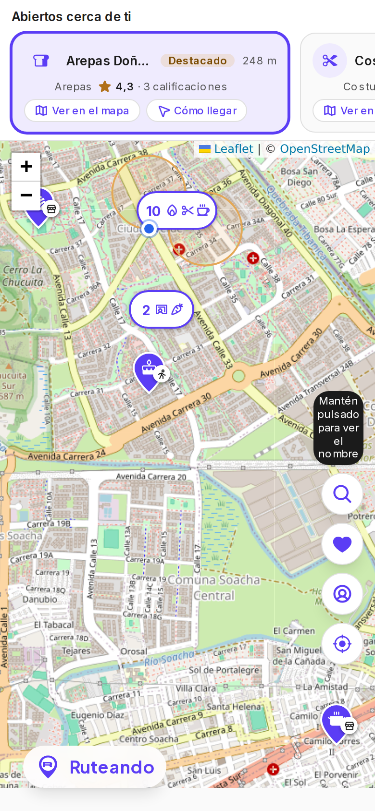
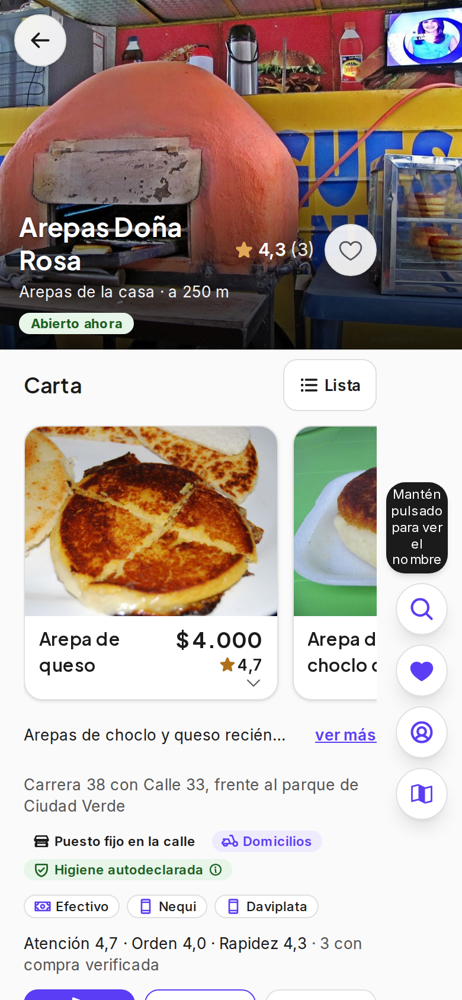
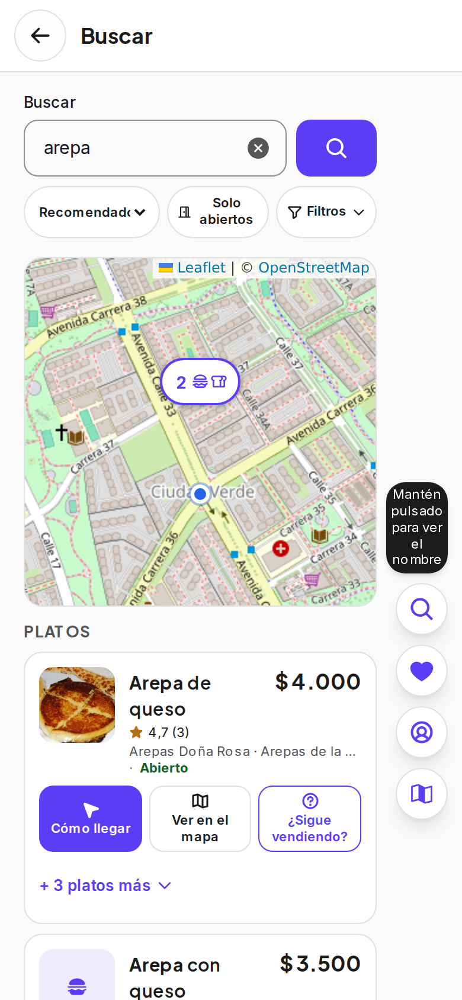
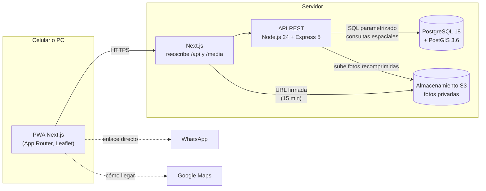

# RUTEANDO

**El mapa del comercio informal de tu barrio.** RUTEANDO conecta a los
vecinos de Ciudad Verde (Soacha, Colombia) con quienes venden en la calle:
arepas, tintos, empanadas, costureras, artesanos, asesorías. El vendedor se
registra sin registro mercantil; el cliente lo encuentra en un mapa, ve si
está vendiendo **ahora mismo** y le escribe por WhatsApp o llega con Google
Maps.

> Este repositorio es una **vitrina**: muestra qué es el proyecto, cómo está
> construido y por qué. El código fuente vive en un repositorio privado.
> Todos los derechos reservados (ver [LICENSE](LICENSE)).

  

  
  
  

## El problema

En Ciudad Verde, uno de los macroproyectos de vivienda más grandes de
Colombia, buena parte de la comida y los servicios del día a día los ofrece
el comercio informal. Ese comercio es invisible en las plataformas
existentes: piden registro mercantil, cobran comisión por pedido o
asumen un local fijo. El vecino no sabe qué hay cerca ni si el vendedor ya
salió; el vendedor no tiene cómo avisar.

## La propuesta

- **Sin intermediar la venta.** No hay pagos ni pedidos dentro de la app:
  RUTEANDO es un intermediario de información. La compra sigue siendo entre
  vecinos, por WhatsApp o en persona.
- **"Vendiendo ahora" honesto.** Lo que depende del vendedor dice cuándo se
  confirmó ("confirmado hace 12 min"). Nada se da por cierto con un
  temporizador.
- **Para quien vende con una mano.** Pocas pantallas, pocas palabras, una
  acción principal por pantalla; lo demás se despliega en el mismo lugar.
- **Puesto fijo, ambulante o a domicilio.** El mapa distingue la modalidad
  y, si el vendedor quiere, muestra su ubicación en vivo mientras vende.

## Arquitectura

- **Contrato primero.** La API está descrita en OpenAPI 3.1 (más de 100
  rutas) y el cliente del frontend se genera tipado desde ese contrato: si
  una ruta cambia y el contrato no, el build falla.
- **Cercanía con PostGIS.** "Qué hay cerca" es una consulta espacial con
  índice GiST sobre `geography`; una prueba de integración revisa el plan
  de ejecución (`EXPLAIN`) para garantizar que nunca degrade a un recorrido
  completo de la tabla.
- **Fotos privadas.** El bucket no es público: cada foto se entrega con una
  dirección firmada de corta duración.
- **Esquema versionado.** Migraciones con `node-pg-migrate`; tablas y enums
  en español (el dominio), la API en inglés.

## Stack

| Capa | Tecnología |
|---|---|
| Frontend | Next.js (App Router) como PWA, React 19, Tailwind CSS 4, Leaflet, Phosphor Icons |
| Backend | Node.js 24, Express 5, Pino, argon2, sharp |
| Datos | PostgreSQL 18 + PostGIS 3.6, node-pg-migrate |
| Archivos | Almacenamiento compatible con S3 (MinIO en desarrollo) |
| Pruebas | Jest + Supertest contra Postgres real, Playwright |
| Operación | Docker Compose, pm2, GitHub Actions, gitleaks |

## Seguridad

Basada en el **OWASP API Security Top 10** y **NIST SP 800-63B**, como reglas
no negociables desde la primera línea:

- **Autorización por objeto** en todo endpoint con un id: antes de editar o
  borrar un negocio, producto o foto, el servidor comprueba que sea del
  usuario. El panel de administración rechaza en middleware a quien no sea
  administrador, con su propia firma de tokens.
- **Contraseñas con argon2.** El inicio de sesión verifica contra un hash
  de relleno cuando el correo no existe, para que el tiempo de respuesta no
  revele qué cuentas existen ([fragmento](fragmentos/login.js)).
- **Sesión según RFC 9700.** Token de acceso corto que vive solo en memoria
  del navegador (nunca en `localStorage`) y token de refresco rotativo: si
  un token ya usado vuelve a aparecer, se revocan todas las sesiones del
  usuario ([fragmento](fragmentos/refresh.js)).
- **Nada de lo que manda el cliente se da por bueno:** tipo, rango y
  formato de cada campo se validan en el servidor, incluidas las
  coordenadas (deben caer dentro de Cundinamarca). SQL siempre
  parametrizado.
- **Fotos:** se revisa el tipo real del archivo (no la extensión), el
  tamaño y los píxeles, y se recomprime en el servidor, lo que también borra
  los metadatos EXIF con la ubicación de quien tomó la foto.
- **Errores en RFC 9457** (Problem Details), sin trazas internas
  ([fragmento](fragmentos/errores.js)).
- **Secretos fuera del código**, revisados con gitleaks sobre todo el
  historial.

## Privacidad (Ley 1581 de 2012)

- Ningún dato personal sin **consentimiento explícito previo**, guardado
  con la fecha y la versión del texto aceptado (nunca un sí/no suelto).
- La ubicación del negocio es pública; **la del cliente solo se usa para
  calcular cercanía y no se guarda.**
- Solicitud de eliminación de la cuenta desde la propia app.
- Respaldos cifrados: la base y las fotos solo salen del equipo cifradas.

## Pruebas

| Tipo | Cantidad aproximada | Cómo |
|---|---|---|
| Unitarias e integración (backend) | 940 | Jest contra PostgreSQL/PostGIS real, sin simular la base |
| De navegador (e2e) | 120 | Playwright en tamaño celular y PC, con la app completa levantada |
| Manuales | una guía por cambio | En PC y en un celular Android de gama media antes de fusionar |

Todo endpoint con sesión prueba también el rechazo (401/403). El CI de
GitHub Actions corre lint, migraciones desde cero, la suite del backend, el
build del frontend y, en cada PR a integración, la suite de navegador.

## Decisiones que vale la pena contar

- **Sin pagos dentro de la app.** Reduce la responsabilidad legal, evita
  comisiones que el comercio informal no puede pagar y mantiene la compra
  entre vecinos.
- **Ver negocios requiere cuenta.** Los datos de contacto de los vendedores
  no quedan expuestos a extracción masiva; cada cuenta tiene además un
  límite de lecturas.
- **"Vendiendo ahora" sin cron.** El estado se calcula con el aviso más
  reciente del vendedor y la hora en que se confirmó; no hay un proceso que
  lo "venza" a escondidas.
- **Una sola fuente de íconos.** Cada ícono tiene un único significado en
  toda la app, para que quien tiene poca práctica digital aprenda una vez.
- **Lo que no se probó es una hipótesis.** Cada hallazgo que sale solo de
  leer el código se registra como "sin verificar" hasta comprobarlo con la
  app corriendo o con una prueba.

## Cómo trabajo

- **Desarrollo guiado por especificaciones, con IA.** Cada funcionalidad
  empieza como una spec en español (qué problema resuelve, para quién, qué
  queda fuera) que apruebo antes de escribir código. La implementación la hago
  con un asistente de IA (Claude Code) que trabaja sobre esa spec y sobre unas
  reglas fijas del proyecto: seguridad, privacidad, pruebas y cómo registrar
  cada decisión. Antes de construir, se verifica qué ya existe en el código
  (existe / parcial / falta) para no rehacer lo que ya está.
- **Decisiones con su porqué.** Toda decisión técnica o de producto queda
  escrita en un historial por tema, con la razón y las alternativas que se
  descartaron; lo que solo se dedujo leyendo el código se marca como
  "hipótesis sin verificar" hasta probarlo.
- **Pruebas en cada cambio.** Unitarias e integración contra la base real (sin
  simularla), pruebas de navegador para cada pantalla y la regla de no dar
  nada por terminado solo porque responde bien en el caso feliz. El CI corre
  todo en cada PR y nada se fusiona en rojo.
- **Prueba manual en PC y en un celular real.** Antes de fusionar un cambio de
  comportamiento lo pruebo yo mismo en el computador y en un Android de gama
  media, con una guía corta de pasos y resultados esperados. Lo que sale de
  esa prueba vuelve como una spec de ajustes.
- **Ramas cortas y PR pequeños**, con Conventional Commits, `develop` como
  integración y `main` siempre desplegable.

## Estado

En desarrollo activo, con piloto previsto en Ciudad Verde. Las capturas
usan datos de demostración ficticios.

## Créditos de las capturas

Las fotos de los platos son de Wikimedia Commons, con licencia
[CC BY 2.0](https://creativecommons.org/licenses/by/2.0/), y se muestran
recortadas dentro de la interfaz:
[Horno para hacer ricas arepas de choclo](https://commons.wikimedia.org/wiki/File:Horno_para_hacer_ricas_arepas_de_choclo.jpg)
y [Arepa de chocolo](https://commons.wikimedia.org/wiki/File:Arepa_de_chocolo.jpg),
de Nelson Fernando Sotelo Castro;
[Arepa de queso](https://commons.wikimedia.org/wiki/File:Arepa_de_queso_by_jslander.png),
de Jess Lander. Mapas © colaboradores de
[OpenStreetMap](https://www.openstreetmap.org/copyright) (ODbL).

## Contacto

<!-- Completa tus datos aquí -->
- Correo: _(por completar)_
- LinkedIn: _(por completar)_
- Ciudad: _(por completar)_

---

Hecho por Fernando Melendez · © 2026 · Todos los derechos reservados.
